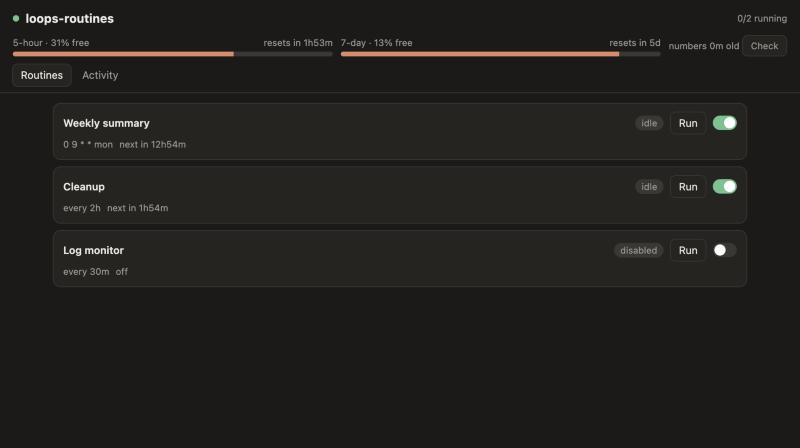

# loops-routines

[](https://github.com/Melevir/loops-routines/actions/workflows/ci.yml)
[](https://pypi.org/project/loops-routines/)
[](LICENSE)

**Claude Code agents that run on a schedule, in the background, on your Mac, and spend only the part of
your plan you choose.**

Your Claude plan resets every 5 hours, and whatever you didn't use is gone. loops-routines turns that
leftover into work: a weekly changelog, a log check every half hour, a small cleanup PR whenever tokens
would otherwise expire. Each routine is one Markdown file — a few settings and a prompt.

- ⏰ **Cron or intervals** — `0 9 * * mon`, `every 30m`, only inside `mon-fri 07:00-11:00`.
- 🪫 **Budget-aware** — start only with spare tokens, keep a reserve, wind a run down before it eats into
  your own work.
- 🔔 **Tells you, asks you** — macOS notifications, and dialogs with the agent's own buttons that wait for
  your click.
- 🤖 **Steer it from Claude Code** — "run the log watchdog now", "what did the changelog say?" through MCP.
- 💤 **Sleep-proof** — a Mac that slept all night runs a routine once, not sixteen times.



## Install

Needs macOS and [Claude Code](https://claude.com/claude-code) (`claude` on your `PATH`, signed in).

```bash
brew install melevir/tap/loops-routines   # or: uv tool install loops-routines
loops-routines install --launchd --mcp    # config + examples, the daemon at login, the MCP server in Claude Code
loops-routines status
```

Then drop a recipe below into `~/.loops_routines/routines/`. `loops-routines open` shows the web page.

## Recipes

Each one is a file in [`examples/`](examples). Copy it to `~/.loops_routines/routines/`, change the
repositories and services, and it runs from the next tick; `loops-routines check <file>` shows its
next three runs first.

### 📋 Weekly changelog

**You get:** every Monday morning, a report of last week's merged PRs grouped by theme, and a
notification with the one-line summary.

```toml
+++
title = "Weekly changelog"
schedule = "0 9 * * mon"     # Mondays 09:00
grace = "1d"                 # the Mac slept through it? catch up during the day
model = "sonnet"
notify = "always"            # a banner with the one-line summary when it's ready
+++
Summarise what was merged in the 7 days before {now} in these repositories:
- your-org/backend
- your-org/frontend
...
```

[Full file](examples/weekly-changelog.md)

### 🧹 Spare-token cleanup

**You get:** small, safe draft PRs (dead code, a missing test, a bad name), made only from tokens your
5-hour window would have thrown away.

```toml
+++
title = "Spare-token cleanup"
schedule = "every 2h"
profile = "spare"            # only with 60%+ of the 5-hour window free and a reset within 2 hours
priority = 20                # anything more important goes first
repos = ["your-org/backend"] # cloned fresh into the run's own folder
allowed_tools = ["Bash(make *)", "Bash(uv *)", "Bash(git push -u origin cleanup/*)",
                 "Bash(gh pr create --draft *)"]
max_runtime = "90m"
notify = "on_alert"
+++
In {repos}, pick one small, safe cleanup ...
```

[Full file](examples/spare-cleanup.md)

### 🚨 Log watchdog

**You get:** silence while everything is fine, and a notification the moment a *new* error shows up.
It compares each check with its own previous report.

```toml
+++
title = "Log watchdog"
schedule = "every 30m"
grace = "20m"                # a check that couldn't start in 20 minutes is skipped, not piled up
priority = 80
model = "sonnet"
effort = "low"
max_runtime = "10m"
mcp_servers = ["sentry"]     # whatever logs server you have: `loops-routines integrations` lists them
notify = "on_alert"          # silent while all is well
+++
Check production errors for my-api and my-worker since {last_run_at}. ...
Your previous report, to tell new errors from known ones:
{previous_report}
```

[Full file](examples/log-watchdog.md)

### ☕ Review queue

**You get:** on weekday mornings, the PRs waiting for your review, each in one line with its size and
CI state, the oldest first.

```toml
+++
title = "Review queue"
schedule = "30 8 * * mon-fri"   # weekdays 08:30, before you sit down
window = "mon-fri 07:00-11:00"  # waiting for limits? still only in the morning
model = "sonnet"
notify = "always"
+++
Find the pull requests waiting for my review: `gh search prs --review-requested=@me --state=open`. ...
```

[Full file](examples/review-queue.md)

### 🙋 Dependency bumps, with your OK

**You get:** a dialog on your screen: *"5 bumps are green, 1 looks risky. Approve the safe ones?"*,
with the buttons **Approve safe ones**, **Show me first** and **Skip**. Nothing is approved unless you
click.

```toml
+++
title = "Dependency bumps"
schedule = "0 16 * * fri"
profile = "spare"            # any spare tokens between this Friday and the next
allowed_tools = ["Bash(gh pr review * --approve*)"]
notify = "always"            # a banner with the outcome; the agent may also ask you
+++
List the open Dependabot PRs in your-org/backend with green CI. ...
Then ask me with `ask_user` ... Approve only on "Approve safe ones".
```

[Full file](examples/dependency-bumps.md)

## Ingredients

Everything a routine's header can say. Only `schedule` is required.

**When**

| key | what it does | default |
|---|---|---|
| `schedule` | cron (`0 9 * * mon`, `@daily`) or an interval (`every 30m`) | — |
| `window` | start only inside it: `mon-fri 07:00-11:00`, several joined by `;` | any time |
| `grace` | how long a run may wait for its window and budget before it's skipped | until the next run is due |
| `priority` | 0–100: who goes first when several are due | 50 |
| `enabled` | the switch on the web page, CLI or MCP overrides it | `true` |

**Budget** — percentages of your plan's windows

| key | what it does | default |
|---|---|---|
| `profile` | `any` (whenever due), `spare` (only tokens about to expire), `unlimited`, or your own | `any` |
| `min_free` | start only with this much of the 5-hour window free | profile's |
| `before_reset` | start only if the 5-hour window resets within N minutes | profile's |
| `keep_free`, `keep_free_weekly` | never touch the last N% of the 5-hour / 7-day window: a run that reaches it is wound down | 5, 5 |

**The agent**

| key | what it does | default |
|---|---|---|
| `model`, `effort` | the Claude model and reasoning effort | your `claude` default |
| `max_turns`, `max_runtime` | hard stops | 50, `30m` |
| `repos` | `owner/name` repositories, cloned fresh into the run's own folder | none |
| `mcp_servers`, `plugins`, `skills` | what it may use from your Claude Code setup (`loops-routines integrations`) | none |
| `allowed_tools`, `disallowed_tools` | permissions on top of the safe defaults (read, `git`, `gh` read commands; never force-push or merge) | none |

**Talking to you**

| key | what it does | default |
|---|---|---|
| `notify` | `always`: a notification when it finishes; `on_alert`: only when something is wrong; `never`: quiet. With `always` and `on_alert` the agent may also ask you in a dialog | `on_alert` |

**In the prompt:** `{now}`, `{last_run_at}`, `{previous_summary}`, `{previous_report}`,
`{previous_status}`, `{repos}`, `{run_id}`, `{name}`, `{title}`.

Every run ends with a status (`ok`, `alert` or `nothing`), a one-line summary and a Markdown report,
kept with the run in `~/Library/Application Support/loops_routines/reports/`.

## Steer it from Claude Code

`loops-routines install --mcp` adds an MCP server to Claude Code, so you can just ask:

- *"What did the weekly changelog say?"*
- *"Run the log watchdog now, outside the queue."*
- *"Switch off the cleanup."*
- *"Which routine is waiting, and why?"*
- *"Answer the dependency question: Show me first."*

The same from the terminal:

```bash
loops-routines status                 # every routine: idle, waiting (and why), running
loops-routines run log-watchdog --now # start one now, even with all slots busy
loops-routines runs                   # recent runs; `get RUN` for one report
loops-routines disable spare-cleanup
loops-routines watch                  # live events
```

## How it decides when to run

- Only the **latest** due run counts: a sleeping Mac catches up once.
- A due run **waits** for its window and budget until `grace` runs out (or the next one is due). Then
  it's recorded as **skipped**, with the reason.
- With several due: higher `priority` first, at most `max_parallel` (2) at a time, never two of the same
  routine.
- Budget numbers come from your own runs; when they're older than 30 minutes, one tiny haiku request
  refreshes them.

## Good to know

- **macOS only** for now: notifications, dialogs and the LaunchAgent are macOS's.
- **Routines spend your plan.** Every run is a `claude -p` session on your sign-in. Start with
  `profile = "spare"` for anything that doesn't have to run.
- **Agents act as you,** with your files, keychain and `gh` login, limited by their allowed tools. Read
  [SECURITY.md](SECURITY.md) before switching on a routine that pushes, posts or reads untrusted text.
- Upgrade with `brew upgrade loops-routines` (or `uv tool upgrade`), then `loops-routines restart`.
  Remove with `loops-routines uninstall`; `~/.loops_routines` is kept.

## More

- [How it works](docs/architecture.md): the daemon, the scheduler, results, notifications, the REST API
  and MCP tools.
- [Contributing](CONTRIBUTING.md) · [Changelog](CHANGELOG.md) · [Security](SECURITY.md)

---

An independent project, not made or endorsed by Anthropic. "Claude" and "Claude Code" are Anthropic's
trademarks; loops-routines only starts the `claude` command you already have. [MIT](LICENSE) licensed.
